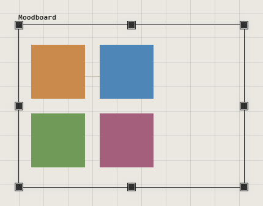
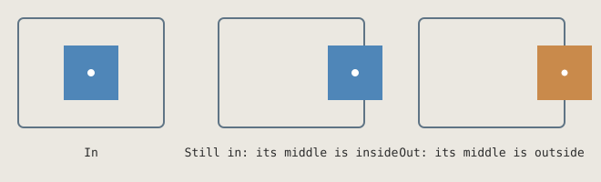
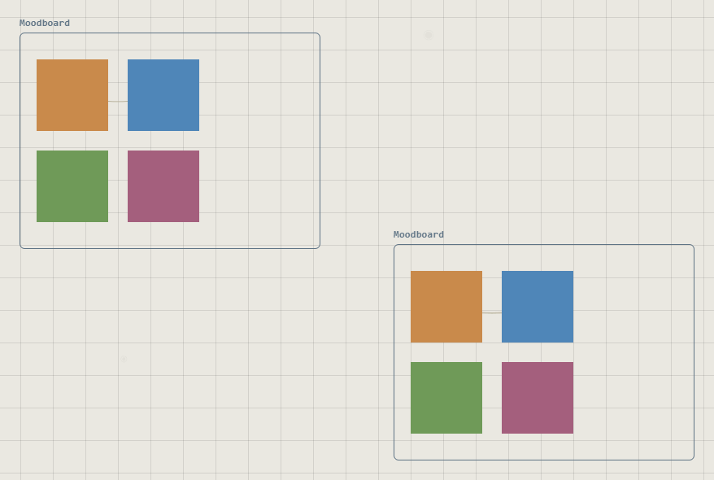
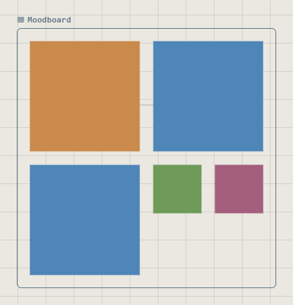

# Frames

A frame is a titled box that holds traces. Move it, copy it or export it, and
what's inside goes with it.

## Make a frame

| You want | Do this |
|---|---|
| A frame of a chosen size | Press **8**, drag on the canvas, then press **Esc** |
| A frame of the usual size | Press **8**, click the canvas, then press **Esc** |
| A frame from the menu | Right-click the canvas > **Frame** |
| A frame around traces you've placed | Select them, right-click one > **Wrap in Frame** |

Loose traces inside a new frame go into it.

## Put traces in and take them out

Drag a trace in and let go: it's in. Drag it out: it's out. The **middle** of
the trace decides.

- A trace over the edge still shows in full. Frames don't cut anything off.
- A group goes in and out whole, by the middle of the whole group.
- If two frames overlap, the smaller one gets the trace.
- Dragging a frame across other traces doesn't pick them up.

## Move, resize, rename

| To | Do this |
|---|---|
| Move it | Drag its title or edge |
| Resize it | Select it, drag a handle. What it no longer covers leaves; loose traces it now covers join |
| Rename it | Double-click the title |
| Open its menu | Right-click the title or edge |
| Change its look | Select it > **Customize**: name, background, border, corners, shadow, light |

Clicks on the empty inside go through to the canvas, so right-clicking there
opens the canvas menu.

## Copy a frame

**Duplicate** or copy and paste. The copy holds copies of everything inside,
including groups and the connections between them. One **Ctrl+Z** removes it all.

A trace copied on its own joins the frame it lands in, or none.

## Arrange automatically

Right-click the title > **Arrange Automatically**. What's in the frame lays
itself out in columns, and again whenever you add, move or resize something.
**▦** in the title means it's on.

- Traces are **resized to the column's width**, keeping their shape. A group
  counts as one.
- The frame keeps its width and top, and grows or shrinks downward.
- Change the frame's width to change the number of columns (each about 240 wide).
- Drag a trace to change its place in the order.
- Traces you drop or paste inside join at once.
- Choose it again to switch it off: everything stays where it is, at its new size.
  To get the old sizes back, press **Ctrl+Z** past the moment you switched it on.

## Delete a frame

Select it and press **Delete**. Only the frame goes; what it held stays where it
is. **Ctrl+Z** brings the frame back, holding the same traces.

## Good to know

- Frames can't go inside other frames.
- Frames can't be rotated or cropped.
- A selection box picks up a frame only if the whole frame is inside the box.
- Outside an arranged frame, a new trace you place inside doesn't join until you
  move it.

## Related

- [Groups and the Layers panel](groups-and-layers.md): a group ties traces together and has no box or title. Use a frame for a visible area, a group for traces that should always move as one.
- [Selecting](selecting.md): **Direct select** picks a trace inside a frame or group.
- [The Customization panel](../making-it-look-right/customization-panel.md): a frame's look.
- [Locations and presenting](../moving-around/locations-and-presenting.md): save a view of a frame and fly back to it.
- [Export](../keeping-and-moving/export.md): exporting a selected frame includes what it holds.
