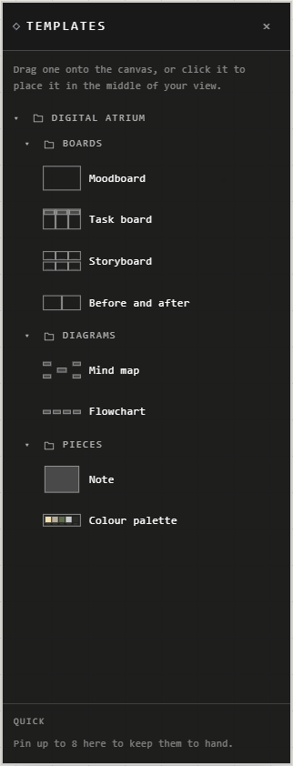

# Templates

Ready-made sets of traces, kept in folders. Place one, then change it as you like:
it becomes ordinary traces, and the template stays as it was.

## Place a template

Open **Templates** in the top bar.

| You want | Do this |
|---|---|
| It in a chosen place | Drag it onto the canvas |
| It in the middle of your view | Click it |

**Ctrl+Z** removes the whole template in one step.

## Keep your favourites to hand

Point at a template and press its **pin**. It moves to **Quick** at the foot of the
sidebar, where you drag or click it the same way. You can pin up to 8. Press the
pin again to take it off.

## What's in the Digital Atrium folder

| Folder | Template | What you get |
|---|---|---|
| Boards | **Moodboard** | A frame that arranges what you put in it into columns |
| Boards | **Task board** | Three frames, To do, Doing and Done, with a card in each |
| Boards | **Storyboard** | Six numbered frames, each with a caption |
| Boards | **Before and after** | Two frames side by side |
| Diagrams | **Mind map** | A main idea joined to four more |
| Diagrams | **Flowchart** | Four steps joined by arrows |
| Pieces | **Note** | A box of text |
| Pieces | **Colour palette** | A frame of five colours, with their codes |

Their words come in your language, and their colours follow the atrium's look.

## Good to know

- You can't make your own templates yet.
- A template dropped on a frame sits on top of it without joining. To put it in the
  frame, move it a little after placing it.
- Pins are kept on this device.
- You need permission to edit the atrium: **Templates** doesn't show in view-only
  atriums.

## Related

- [Frames](../arranging/frames.md): most templates are built from them, and how **Arrange Automatically** works.
- [Connections](../arranging/connections.md): the threads in a mind map or flowchart.
- [Import](../keeping-and-moving/import.md): add a whole `.atrium` file to an atrium.
