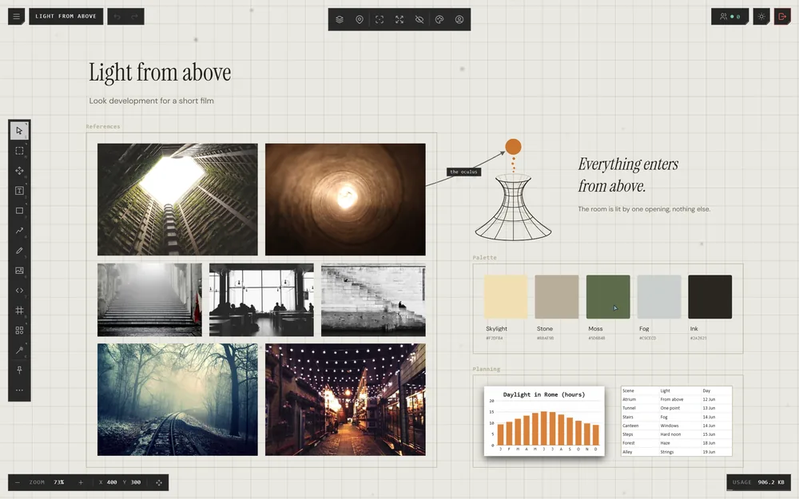

# What is an atrium?

An **atrium** is an endless canvas. A **trace** is anything you put on it:
a picture, a video, a note, a shape, a file.

## What a trace can be

| Trace | What it holds |
|---|---|
| Text | Words in a box, or plain |
| Image | A picture from your computer or the web |
| Embed | A live web page or link: YouTube, Pinterest, and any page that can be framed |
| Shape and path | Boxes, circles, lines and arrows |
| Drawing | Strokes drawn with a brush |
| Frame | A titled box that holds other traces |
| Sound, Video | Files that play where you put them |
| PDF, slides | Documents you can page through |
| Sheet, Chart | A spreadsheet's tables and charts |

## What you do in an atrium

| To | Go to |
|---|---|
| Move around the canvas | [Moving around](../moving-around/moving-around.md) |
| Add traces | [The quick bar](../bringing-things-in/quick-bar.md), or [drop and paste](../bringing-things-in/drop-and-paste.md) |
| Keep traces together | [Frames](../arranging/frames.md), [groups and layers](../arranging/groups-and-layers.md) |
| Show how ideas relate | [Connections](../arranging/connections.md) |
| Change how things look | [The Customization panel](../making-it-look-right/customization-panel.md) |
| Work with other people | [Sharing](../working-together/sharing.md) |

## Good to know

- Each atrium is kept in one place: this browser, the Atrium's cloud, your Google
  Drive, or the desktop app's folder. See [Where atriums live](where-atriums-live.md).
- Press **?** inside an atrium to open this help.

## Related

- [Where atriums live](where-atriums-live.md): the differences, before you make one.
- [Your first atrium](first-atrium.md): making one, step by step.
