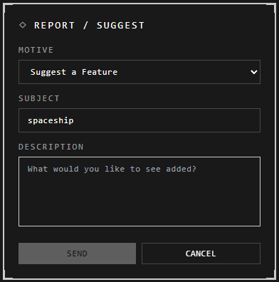

# Report a problem or suggest a feature

Fill in the form and press **Send**. It goes straight to the developer, and you
stay where you are.

## Open the form

| From | Do this |
|---|---|
| An atrium | **Atrium menu** > **Report a Problem** |
| Anywhere | Open **Help** (**?** in an atrium, or the **?** button at the top of the atrium browser), then **Report a problem or suggest a feature** at its foot. What you searched for becomes the subject |

## Fill it in

| Field | What to write |
|---|---|
| **Motive** | **Report a Problem**, **Suggest a Feature** or **Other** |
| **Subject** | A short summary. Optional |
| **Description** | What happened and the steps that lead to it, or what you'd like added |

For a problem, it helps to say what you did, what you expected, and what happened
instead. The form also sends your username, the atrium's name, and whether you're
on the web or the desktop app.

## Good to know

- **Replies:** the developer can answer only if you're signed in with a confirmed
  address or a Google account. Otherwise your report still arrives, with no way to
  reply.
- **Limit:** a few reports an hour from one network. If it says to wait, try again
  later.
- **If it can't send**, your email program opens with the report filled in.

## Related

- [When something breaks](when-something-breaks.md): common problems and what to try first.
