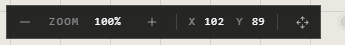

# Moving around

Drag empty canvas to move the view. Use the wheel to zoom.

## Move the view

| To | Do this |
|---|---|
| Move the view | Drag empty canvas |
| Move it from anywhere, even over a trace | Drag with the **middle mouse button** |
| Drag only moves the view, until you stop | Press **H**, drag, then press **H** or **Esc** |

## Zoom

| To | Do this |
|---|---|
| Zoom in or out | **Wheel** or pinch, or **+** and **−** |
| Go back to 100% | Press **0** |

## Lost? See everything

Press **Shift+1**, or the **Recenter** button in the bar at the top. The view fits
all your traces.

## The bar at the bottom left

| Part | What it does |
|---|---|
| **−** and **+** | Zoom out and in |
| The percentage | Click to go back to 100% |
| **X**, **Y** | Where your pointer is on the canvas |
| The four arrows | Hold it and move the mouse to move the view |

## Good to know

- To change how far one notch of the wheel zooms, open **User Preferences** >
  **Zoom speed**.
- Arrows at the edge of the screen can point to traces out of view: **User
  Preferences** > **Point to off-screen traces**.

## Related

- [Minimap and view](minimap-and-view.md): a small map of the whole atrium, and hiding the interface.
- [Locations and presenting](locations-and-presenting.md): save a view and fly back to it.
- [Keyboard shortcuts](keyboard-shortcuts.md): every key, on one page.
